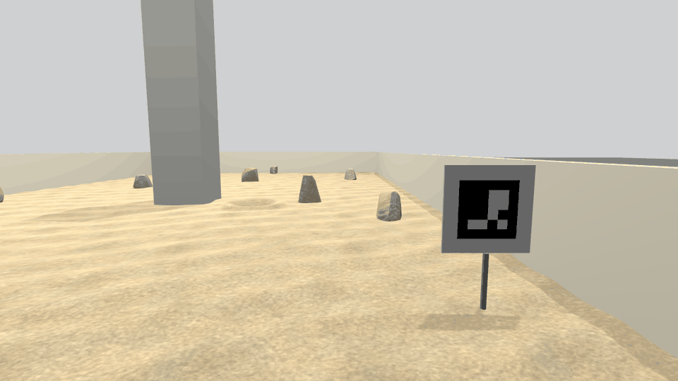
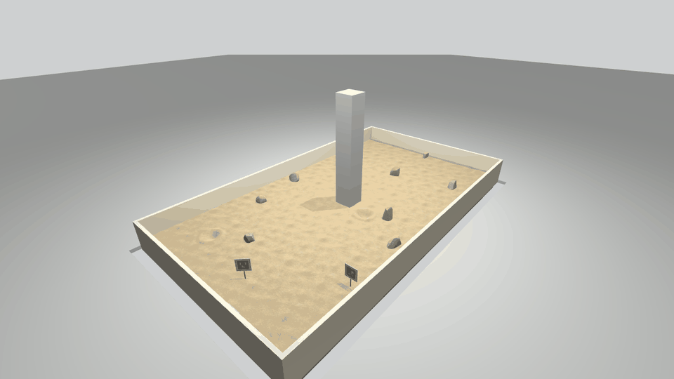
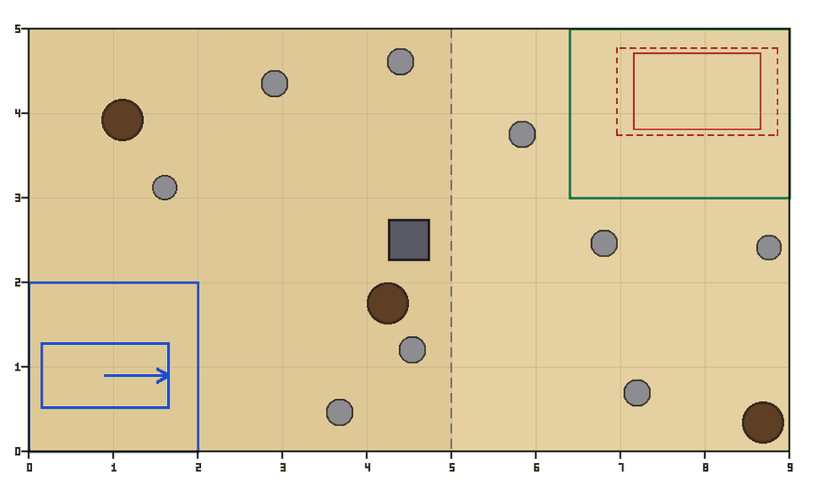

# cac_sim
**Owner:** Mission/Sim/Ops

Gazebo Harmonic model of the 9 x 5 m CAC 2027 sand arena (tilled sand, boulders, craters, central column, walls) and a seeded randomiser for obstacles and the start pose. Design contract: `DESIGN.md`.

## Words used here

- **Arena frame / origin:** the coordinate system of the arena. Origin (0, 0) is the inner corner where the west and south walls meet, at the start-zone corner. x runs along the 9 m side, y along the 5 m side.
- **Zones:** `start` (2 x 2 m, no obstacles), `obstacle` (the first 5 m), `excavation` (the last 4 m, where sand may be dug), `construction` (where the berm is built).
- **Truth:** the file (`truth/truth.yaml`) with the true obstacle positions. For scoring and setup only. The robot never reads it.
- **ASSUMED:** a value the rulebook does not give. Our best guess; change it in `config/arena.yaml`.
- **Slalom:** the judges must force a route that weaves between obstacles.
- **SE(2) path check:** a check that a 1.5 x 0.75 m rover can actually drive AND turn through the field.
- **Seed:** a number that fixes the random layout. Same seed, same arena.

| Robot view from the start zone | Overview | Layout (`truth/map.png`) |
|---|---|---|
|  |  |  |

## Run a world

`colcon build` generates and installs these worlds: `schematic` (organiser's example layout), `empty`, the five stress layouts (`gate`, `column_pinch`, `crater_field`, `busy_dig`, `start_trap`; see below), `seed_0001` to `seed_0005`.

Installed worlds live at `$(ros2 pkg prefix cac_sim)/share/cac_sim/worlds/<name>/arena.sdf`. `seed_0001` to `seed_0005` have the same `arena.sdf` as `generate_arena --layout random --seed 1..5` output (checked for seed 1; the installed copy has no `truth/`).

```bash
source install/setup.bash
gz sim -r $(ros2 pkg prefix cac_sim)/share/cac_sim/worlds/schematic/arena.sdf
gz sim -s -r <world>      # headless server, no GUI
gz sim -s -r --headless-rendering <world>   # headless, but cameras/LiDAR still render (slow PCs)
```

The worlds select their physics engine themselves (DART by default; no `--physics-engine` needed); see "Physics engine".

**Give every Gazebo its own partition.** Gazebo finds other Gazebo instances on the same network
automatically, so two teammates on the same Wi-Fi (or two sims on one PC) silently connect: your
window shows someone else's world, or your robot gets their commands. Put this in your `~/.bashrc`
(inside the container too) with your own name:

```bash
export GZ_PARTITION=$USER-$(hostname)
```

Arena frame: origin at the start-zone corner, x along the 9 m side, y along the 5 m side, z = 0 at the undisturbed sand. The Gazebo world frame is the same frame.

## Generate new arenas

```bash
ros2 run cac_sim generate_arena --layout random --seed 42 --out /tmp/arenas
ros2 run cac_sim generate_arena --layout random --seed 100 --count 20 --out /tmp/arenas   # seeds 100..119
ros2 run cac_sim generate_arena --layout my_layout.yaml --out /tmp/arenas
```

From the source tree, `src/cac_sim/scripts/generate_arena` works the same. It prints the path and the `gz sim` command for each world.

| Flag | Effect |
|---|---|
| `--layout` | `schematic`, `empty`, `random`, a stress layout name (below) or a layout YAML file |
| `--seed N`, `--count K` | random layouts for seeds N .. N+K-1 (same seed = same arena) |
| `--out DIR` | one sub-directory per world; the SDF uses relative paths, so it can be moved |
| `--markers` | ArUco boards from `arena.yaml` (needs `python3-opencv`; without it, or with a wrong dictionary name, the CLI prints an error to stderr and exits non-zero) |
| `--config FILE` | `arena.yaml` override (default: the packaged one) |
| `--marker-preset NAME` | `frame_inner` (start zone's inner edges, default) or `perimeter_walls` (the west and south walls). The rule text allows both readings; see `arena.yaml` |
| `--setup-sheet` | also writes `truth/setup_sheet.md` and `truth/setup_plan.png`, so a physical mock arena can copy the layout (see below). Nothing else changes. Reveals obstacle positions, so it stays with the truth |
| `--sitcams` | the two situational cameras, 1280x720 at 5 Hz, `/sitcam/<name>/image` |
| `--overlay` | zones, target box and start footprint drawn on the sand (visual only, for debugging) |
| `--low-gfx` | no shadows at all, for slow laptops (lighting is otherwise unchanged) |
| `--sand-collision mesh\|tiles` | override `sand.collision` (default `tiles`: flat sand is boxes, craters are mesh patches). `mesh`: one collision mesh with the tilled relief; on bullet-featherstone ~40 % slower physics, on dart friction-inert. See "How the sand drives" |
| `--physics-engine dart\|bullet-featherstone` | override `physics.engine` (default `dart`: it skid-steers our rover; bullet-featherstone enforces mimic joints but cannot turn). Sets `<physics type>` and the Physics system's `<engine>` plugin. See "Physics engine" |
| `--vary-appearance` | off by default. Seeded change of the look only: light level, key direction, ambient, colour temperature, sand tint/brightness/contrast, rock palette, wall colour. Geometry, collision, layout and truth stay byte-identical. Ranges (all ASSUMED) in `arena.yaml` `appearance:` |
| `--appearance-seed K` | seed for the look only (implies `--vary-appearance`); default is the layout seed, so "seed 7" stays one fixed scene |

Output folders are named `seed_0007` (seed 7, four digits) or `schematic` / `empty` / the layout file's name. Each world directory holds `arena.sdf`, `meshes/`, `materials/` and a `truth/` sub-directory (`truth.yaml`, `map.png`). A smaller mock arena should use a custom `--config` (rocks and craters do not scale down).

### Building a field in the mock arena

`setup_sheet.md` is a tape-measure checklist: every obstacle sorted by x, in cm from the west-south inner corner, plus the start pose, column, markers (with `--markers`) and pre-run checks.
`setup_plan.png` is the labelled plan (50 cm grid, each obstacle marked with its id).
Peg each centre, place the obstacle, tick the row, then remove the pegs before the robot runs.

Marker boards are visual only; free-standing ones get a thin collision post and are moved just clear of the start zone. The CLI warns if the marker list breaks the rules (max 4, below 0.60 m). The posts are real obstacles: the randomiser and all path checks (and the truth paths) always keep room for the configured preset's posts, with or without `--markers`.

CLI messages go to stderr: `warning [name]` = a hard problem (overlapping obstacles, an obstacle centre outside the arena, no path), `info [name]` = a deviation from the rulebook or our margins only, such as a crater rim reaching past a wall (the schematic prints a few of these: it is the organiser's drawing). Obstacles keep `randomiser.start_zone_margin` / `construction_zone_margin` (in `arena.yaml`) from those zones.

Lighting imitates the indoor hall of the Artemis Arena: a dim directional key plus four overhead lamps 4.5 m above the sand, a high ambient so shadowed sides are not black, a neutral grey background and a visual-only grey hall floor starting 0.3 m outside the walls (no collision). Only the key casts shadows (one shadow pass, cheap enough for CPU laptops); `--low-gfx` turns even that off. Walls are beige, the column concrete grey. Rocks use three texture variants plus normal maps (sand and rock).

Use `--vary-appearance` to test perception against venue conditions you cannot know in advance (dim or warm hall, greyer sand, other wall paint). The same layout with `--appearance-seed 1..N` gives N looks of one fixed obstacle field.

## Stress-test layouts

Hand-made, rule-legal layouts in `layouts/` that each push one hard case. Every one passes the hard
checks and leaves a route for the 1.5 x 0.75 m footprint; the comment block at the top of each file
says what it stresses, why, and what a good robot does. Run one by name (installed worlds are in
`share/cac_sim/worlds/<name>/`; from the source tree use `src/cac_sim/scripts/generate_arena`):

```bash
ros2 run cac_sim generate_arena --layout gate --out /tmp/arenas
gz sim -r /tmp/arenas/gate/arena.sdf
```

| Name | What it stresses | Start pose (x, y, heading) |
|---|---|---|
| `gate` | A barrier across the obstacle zone with ONE gap, 5 cm wider than the SE(2) minimum for the rover: precise planning, costmap inflation | (1.0, 1.4), east |
| `column_pinch` | The only route is the lane between the column and a shallow crater: negative-obstacle detection next to a tall obstacle | (1.0, 1.4), east |
| `crater_field` | 7 shallow craters (depth ratio 0.10-0.12) on the travel route, few boulders: crater detection, the hardest perception case | (1.0, 1.0), east |
| `busy_dig` | Normal obstacle zone, but the excavation zone holds the maximum boulders and craters around the dig spot and haul route: dig spot choice, dig to berm haul | (1.0, 1.0), east |
| `start_trap` | Boulders right outside the start zone, one exit to the north, start facing the west wall: turning in place, leaving the start zone | (1.0, 1.0), west |

`gate` is the only one that breaks a strict rule (its gap is a straight corridor, so the 'slalom' rule
reports it, on purpose). `test/test_stress_layouts.py` checks every one, and that the gate stays
within 10 cm of the SE(2) minimum if the limits in `arena.yaml` change.

## Ground truth rule

`truth/truth.yaml` lists every obstacle, zone and the start pose, and `truth/map.png` draws them. They are for the test harness and scoring **only**. The robot stack must never read them: the rules forbid uploading obstacle locations, and the robot has to find obstacles with its own sensors. The CLI prints a warning to that effect on every run.

The installed worlds (`share/cac_sim/worlds/<name>/`) contain no truth, and truth is not installed anywhere (any node can read `share/`). Truth is generated only with `--out`: the harness generates the arena it tests on and keeps the truth itself.

## Assumptions

Everything the rulebook does not give us (wall height, column position and size, rock heights, crater depth, marker size, camera positions, and so on) is marked `ASSUMED` in `config/arena.yaml`, with where the guess comes from. The CAC arena text is copied from the NASA Lunabotics guidebook, so the Lunabotics Artemis Arena is the reference for the guesses: a square ~0.5 m column near the centre, low walls ~0.5 m, and an optional PVC duct along the walls (`wall.inner_pipe_diameter`, off by default). Geometry, rule limits, randomiser margins, sand friction, rock sink and the situational-camera sensor (fov, resolution, rate, clip) are all in that file; change it there and rebuild. Only the lighting rig (`KEY_DIFFUSE`, `LAMP_DIFFUSE`, `AMBIENT`, `BACKGROUND`, lamp height) and the colours of walls, column, floors and hall are named constants at the top of `cac_sim_gen/world.py`; `--vary-appearance` scales those same constants. Where the rulebook table and the schematic disagree (berm and target size), the smaller pair is the default.

## Tests

`colcon test --packages-select cac_sim` (pytest in `test/`). The randomiser tests use 60 seeds so CI
stays quick. After changing the randomiser or the limits in `arena.yaml`, run the full sweep:
`CAC_SIM_SEEDS=500 colcon test --packages-select cac_sim` (about 3 minutes).

## What the sensors see (measured in this sim)

Craters are shallow bowls: 3-12 cm deep for 30-50 cm wide (see `arena.yaml` for why). That makes them
**much harder to see than boulders**. Measured with a static sensor 0.5 m above the sand:

| Crater | Depth camera (640x480, 87 deg, pitched 20 deg) | 16-beam LiDAR (tilted 15 deg) |
|---|---|---|
| 30 cm wide, 3-6 cm deep | seen from 1.0-2.0 m | seen from 1.0 m |
| 40 cm wide, 4-8 cm deep | seen from 2.0-3.0 m | seen from 1.0 m |
| 50 cm wide, 5-10 cm deep | seen from 3.0 m | seen from 1.5-2.0 m |

- A 30 cm boulder (12 cm tall) shows up at 3.5 m on the depth camera. The LiDAR loses it at 3.5 m,
  because it falls between beam rings.
- The tilled sand is about 4 mm RMS. No flat-sand point fell below -3 cm in any test.
- These numbers are from the sim, with sim noise. They show the shape of the problem, not the real
  sensor's performance. Re-measure on real sand.

## Physics engine

The worlds run on **DART** by default (`physics.engine` in `arena.yaml`, or
`generate_arena --physics-engine bullet-featherstone`). It is a team decision made from
measurements with the real rover (`cac_description`, numbers below): DART skid-steers it, and
bullet-featherstone does not.

- **DART ignores URDF mimic joints** ("the chosen physics engine does not support mimic
  constraints"). The full `rover.urdf` tips over (pitch -34 deg). So the team drives
  `rover_sim.urdf`: rockers and differential bar fixed, bogies free. DART also drops closed
  kinematic loops, so a real linkage differential is not possible there either.
- **bullet-featherstone enforces the mimic differential** (full `rover.urdf`), but skid-steer
  turning is broken on it (table below). Use it for suspension or differential studies. Do not
  evaluate turning on it.

**`<physics type>` alone does not pick the engine in gz-sim 8.** Measured with `gz sim -v 4`:
a world with `type="bullet-featherstone"` and a bare Physics plugin still loaded
`gz::physics::dartsim::Plugin`. So the generated world also names the engine plugin in the
Physics system:

```xml
<plugin filename="gz-sim-physics-system" name="gz::sim::systems::Physics">
  <engine><filename>gz-physics-dartsim-plugin</filename></engine>
</plugin>
```

With that, plain `gz sim -r arena.sdf` loads the engine the world names; you do **not** need
`--physics-engine` on the command line. `gz sim --physics-engine <plugin> ...` still overrides
the world file (measured). All 12 installed worlds load headless with 0 `[Err]` / 0 `[Wrn]`
(`-v 4`).

Speed, measured on bullet-featherstone with the rover spawned in the start zone and shuttling at
0.2 m/s (gz `DiffDrive`), headless, 2 pinned cores (`--cpuset-cpus 0,1`), CPU only
(`LIBGL_ALWAYS_SOFTWARE=1`), RTF over 20 s:

| World | bullet, `tiles` (default) | bullet, `mesh` | capped (`tiles`) |
|---|---|---|---|
| schematic | 4.82 / 4.93 / 5.07 | 3.04 | 1.00 |
| dense seed 16 | 5.15 / 5.22 / 5.40 | 3.07 | 1.00 |

On bullet-featherstone the whole-arena mesh is ~40 % slower than `tiles`, so `tiles` stays the
default for speed as well as friction. (DART with the tipped full rover ran 3.7-6.0 uncapped; not
a like-for-like number.)

## How the sand drives (measured in this sim)

**The engine decides how sand friction works.** Measured by tilting gravity to tan 0.5 (a block
slides when its effective mu < 0.5) with 0.2 m blocks on the generated schematic arena:

| | dart (default) | bullet-featherstone |
|---|---|---|
| Tag it reads | `<ode><mu>` / `<mu2>` only | `<bullet><friction>` / `<friction2>` only (`<ode><mu>` alone: ignored, stays at 1.0) |
| Sand on the tiles' boxes | honoured | honoured |
| Sand on a mesh (crater patches, `--sand-collision mesh`) | INERT: DART default 1.0 (`AttachMeshShape` drops `<surface>`) | honoured (sand mu 0.3 on the mesh: block slides) |
| Combining sand and wheel/block mu | min(sand, block): sand 0.5 holds, 0.45 slides; 0.6 x 0.6 holds | ~0.7 x sand x block (product): block mu 1.0 holds at sand 0.75 and 0.8, slides at 0.68 and below |
| A collision with no friction tag (e.g. the `cac_description` wheels) | counts as 1.0 | counts as 1.0 |
| Anisotropic `fdir1` + `mu2`/`friction2` | honoured | `friction2` honoured along the link's own y axis; `fdir1` is ignored |
| `<torsional><coefficient>` (SDF default 1.0) | not read | becomes Bullet **spinning friction**, a lever arm in metres; at the default it locks the rover's yaw |

Every sand collision carries the friction twice, as `<ode>` and as `<bullet>`, and
`terrain.torsional` is 0 (harmless on DART, required on bullet-featherstone). The tilt test passes
on both engines: box mu 1.0 on `tiles` slides at sand mu 0.3 and holds at 0.9. On DART the effective
mu on sand is `min(terrain.friction, wheel)`; on bullet it is ~0.7 x the product, so ~0.35 at the
shipped 0.5 with untagged wheels.

**Craters** (`tiles`: each crater is a mesh patch out to its outer radius + 5 cm; the tilled relief
(+/- 1.2 cm) is dropped from the collision and stays in the picture only). A 5 cm sphere dropped
on each crater centre rests 0.6-1.3 mm above `-depth_eff + r` on both engines. **Rocks are solid**
on bullet-featherstone: blocks slid into the 9 schematic rocks either stopped flush against them
or were deflected round them; none passed through. On DART a cylinder wheel gets 2 contact points
on a box and 1 on the mesh. `<max_contacts>` is not honoured by either engine.

### The real rover on sand

Measured with the `cac_description` rover (new CAD: 1.11 x 0.75 x 0.68 m standing, 6 wheels r 0.11 m,
wheelbase 0.89 m, track 0.65 m) in the arena, shipped sand (`tiles`, mu 0.5). The drive is a
**test-only** gz `DiffDrive` (3 left + 3 right wheel joints, `wheel_separation` 0.647,
`wheel_radius` 0.11); odometry is the plugin's, truth is the model pose. Not committed: the robot
plugins belong to the Platform pod.

**DART, `rover_sim.urdf`** (rockers and diff bar fixed, bogies free; isotropic wheels with no
friction tags, so DART's min(wheel, sand) lets the sand's 0.5 set the grip):

| Run | Result |
|---|---|
| 360 deg in place | **360.3 / 360.5 / 360.4 deg** with wheel friction untagged / iso 0.5 / iso 1.0; odometry matches (track 0.647 m); no sliding |
| Arc, 180 deg commanded | 180.6 deg |
| Straight 4 m | 4.0014 m, 0.0 deg heading change |
| 11 cm deep, 50 cm crater under the left wheel line | crosses; max roll 2.4 deg, pitch 2.6 deg, heading deflected 4.8 deg |
| 15 cm steep boulder, head-on (right wheel line) | stalls after ~2.65 m, on either friction (avoid rocks anyway: touching one is a penalty) |
| Full `rover.urdf` (mimics ignored) | tips over (old CAD: pitch -34 deg) |

**bullet-featherstone, full `rover.urdf`** (old CAD; mimic differential enforced; held to 0.06 deg in every run):

| Run | Result |
|---|---|
| 360 deg in place, default sand torsional | **0.2 deg** whatever the wheel friction; odometry says 360 |
| Same, sand and wheel torsional 0 | 53-93 deg (stalls near a world axis) |
| Arc, 1 m commanded | R 4.65-87 m, depending on wheel friction |
| 11 cm crater, default torsional | stuck |
| Off-centre boulder | rolled 57-61 deg |

Bullet-featherstone fixes the friction directions to world x / y instead of the slip direction
(Bullet 3.24, `btMultiBodyConstraintSolver`), which is why turning stalls near an axis. At the
default torsional, spinning friction (a lever arm in metres) also resists every yaw twist.

**Starting point for the Platform pod** (measured facts, not tuned values):
- Drive `rover_sim.urdf` on DART with `wheel_separation` 0.647; odometry then matches truth.
- The new, shorter and wider geometry skid-steers on plain isotropic wheels; no friction tags needed.
  The OLD long-narrow geometry (wheelbase 1.16 m, track 0.57 m) needed anisotropic wheels (`mu1` 0.2
  lateral, `mu2` 1.0 rolling, `fdir1` on the axle). Remember this for future designs.
- Straight-line odometry is exact here. That says nothing about real sand.
- DART cannot do a closed-loop linkage, so the differential stays locked there.

**Not simulated:** rolling resistance, sinkage, bulldozing, tilled relief under the wheels, and
any slip on sand beyond Coulomb friction. Real dry sand gives ~5-10 % straight-line odometry error;
add it on purpose (a scale error and heading drift on the odometry path, or the robot-side
`WheelSlip` plugin) when testing localisation.
